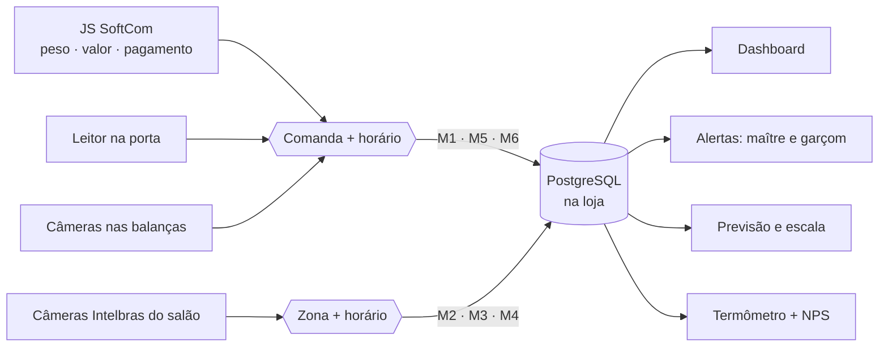

# 🥩 Bovinos Insight
### Do olhômetro à métrica, sem perder o toque humano

> **Hackathon FMU TECH × Grupo Bovinos** · Bovinos Grill & Beer, Rua Augusta · almoço por quilo

**Bovinos Insight** usa visão computacional e os dados da comanda para medir o que hoje é decidido "no olhômetro": o que vai no prato (e quanto ele custa), quanto tempo o cliente espera, quantos desistem na escada, quanto tempo as mesas ficam sujas e quantos clientes virão amanhã. Tudo roda sobre o hardware que a casa **já tem**, com processamento **dentro da loja**.

| 🎬 Vídeo (≤ 2 min) | 📊 Slides (5) | 📄 Desenvolvimento | 🗄️ Banco de dados |
|---|---|---|---|
| **[link do vídeo]** · [arquivo MP4](docs/video/bovinos_insight_demo.mp4) · [roteiro](docs/ROTEIRO_VIDEO.md) | **[link dos slides]** · [PDF](docs/apresentacao_5_slides.pdf) | [DESENVOLVIMENTO.md](docs/DESENVOLVIMENTO.md) | [schema.sql](db/schema.sql) · [SQLite da demo](db/bovinos_insight.db) |

---

## 1. O problema

A unidade da Augusta atende **~600 clientes por dia útil**, concentrados entre **12h10 e 13h20**. O público é executivo e tem de 30 a 40 minutos para almoçar. Hoje a única métrica usada é o **ticket médio**.

| # | Dor | Hoje |
|---|---|---|
| 1 | **Mix do prato** (a mais crítica) | Sabe-se o peso, não *o que* foi servido. 600 g de picanha ≠ 600 g de salada no CMV |
| 2 | **Filas e tempo** | Fila do grill chega a 4 min (meta: 2,5). Se a fila alcança a escada, o cliente desce a Augusta |
| 3 | **Cuidado com as mesas** | Mesa suja é cobrada "no olhômetro" |
| 4 | **Qualidade da comida** | O que sobra no prato se perde no boca a boca |

**Escopo respeitado:** sem cozinha, compras, estoque ou pagamentos; o modelo por quilo continua; nada de catraca (a recepção humana continua).

## 2. A solução

Seis módulos ao longo da jornada do cliente, integrados por **duas chaves**: *comanda + horário* e *zona do salão + horário*.

| Módulo | O que faz | Hardware novo |
|---|---|---|
| **M1 · Prato Inteligente** | Foto do prato na pesagem → YOLO-World + SAM → gramas por categoria usando o **peso real da balança** → CMV por prato | 3 câmeras simples |
| **M2 · Fila Zero** | YOLOv8 + ByteTrack nas câmeras atuais: pessoas, espera, **desistências na escada** e alertas ao maître. Inclui o **Termômetro** "espera agora" para o cliente | nenhum |
| **M3 · Mesa Pronta** | Mesa livre / ocupada / suja por praça, com tempo medido e alerta ao garçom | nenhum |
| **M4 · Buffet Vivo** | Reposições de cuba e resto no prato *(roadmap)* | 1 câmera |
| **M5 · Jornada** | Bip da comanda na porta → entrada, balança e pagamento para **100% dos clientes** | 1 leitor |
| **M6 · Voz + Previsão** | NPS por QR na comanda; previsão de clientes (chuva, feriado, dia) e escala | nenhum |

## 3. Capturas de tela

**1. Dashboard · Jornada e fluxo:** chegadas por 15 min e tempo da entrada até a balança. No pico, o tempo quase dobra.


**2. Dashboard · Mix do prato:** composição do prato por dia e CMV estimado por horário.


**3. Dashboard · Filas e mesas:** pessoas por zona, espera × meta de 2,5 min, desistências e alertas.


**4. Análise do salão:** zonas, contagem, desistências, estado das mesas e alerta ao maître (saída do `video_pipeline`).


**5. Previsão e alertas:** clientes dos próximos 7 dias, escala sugerida e alertas no celular da gerência.


> Os prints usam **dados sintéticos** calibrados com os números da Bovinos. A cena do salão é simulada, mas a análise é feita pelo código real do projeto.

## 4. Arquitetura e integração



- **Edge box na loja** (mini PC com GPU): as imagens entram e morrem lá; **só números saem** (LGPD). Não há reconhecimento facial; os IDs de rastreamento são anônimos e temporários.
- Detalhes de cada algoritmo, do modelo de dados e da validação: **[docs/DESENVOLVIMENTO.md](docs/DESENVOLVIMENTO.md)**.

## 5. Resultados da validação

| Verificação | Resultado |
|---|---|
| Testes automatizados | **5 de 5** passando |
| Desistências simuladas detectadas | **23 de 23** (salão, 90 min) · **8 de 8** (cena do vídeo) |
| Comandas simuladas | **13.162** em 28 dias |
| Entrada → balança | **~4,2 min** fora do pico × **~8,0 min** às 12h45 |

## 6. Estrutura do repositório

```
bovinos-insight/
├── README.md                  ← você está aqui
├── src/                       ← código da solução
│   ├── video_pipeline.py      vídeo/RTSP → filas, desistências, mesas, alertas, vídeo anotado
│   ├── queue_analytics.py     motor de filas (permanência, p90, Lei de Little, desistência)
│   ├── table_monitor.py       estados das mesas
│   ├── alerts.py              regras de alerta + Telegram
│   ├── zone_editor.py         desenho das zonas sobre a câmera
│   ├── plate_mix.py           Prato Inteligente (YOLO-World + SAM + peso)
│   ├── forecast.py            previsão de clientes e escala
│   ├── db.py                  cria o banco SQLite da demo
│   ├── simulate_softcom.py    comandas sintéticas no formato do JS SoftCom
│   └── simulate_salao.py      salão simulado processado pelo motor real
├── dashboard/                 dashboard Streamlit (4 abas)
├── db/                        schema.sql + bovinos_insight.db
├── config/zones.json          zonas de exemplo
├── tests/                     testes (pytest)
├── data/ · outputs/           dados gerados (sintéticos)
├── scripts/                   geradores de prints, vídeo e PDF dos slides
└── docs/
    ├── DESENVOLVIMENTO.md     detalhamento técnico
    ├── ROTEIRO_VIDEO.md       roteiro e narração do vídeo
    ├── apresentacao_5_slides.pdf
    ├── slides/                fonte dos 5 slides
    ├── prints/                5 capturas de tela
    └── video/                 vídeo de demonstração
```

## 7. Como rodar

```bash
pip install -r requirements.txt

python -m src.simulate_softcom          # data/comandas.csv
python -m src.simulate_salao            # outputs/*.csv
python -m src.db                        # db/bovinos_insight.db
python -m pytest -q                     # testes
streamlit run dashboard/app.py          # dashboard

# com o vídeo real da operação
python -m src.zone_editor   --video data/salao.mp4 --out config/zones.json
python -m src.video_pipeline --video data/salao.mp4 --start 2026-11-24T12:00:00 --boxes

# câmera ao vivo (Intelbras)
python -m src.video_pipeline --video "rtsp://usuario:senha@IP:554/cam/realmonitor?channel=1&subtype=0" --show --telegram

# Prato Inteligente
python -m src.plate_mix --img data/pratos/prato1.jpg --peso 0.62 --tema "Comida árabe"
```

## 8. Próximos passos

| Fase | Prazo | Entrega |
|---|---|---|
| 0 · Quick win | 1 semana | Histórico do JS SoftCom + bip na porta + dashboard |
| 1 · Filas | 2–4 semanas | Fila Zero nas câmeras atuais, alertas, Termômetro |
| 2 · Prato | 1–2 meses | Câmeras nas balanças, calibração, modelo próprio |
| 3 · Salão | 2–3 meses | Mesa Pronta, Buffet Vivo, NPS |
| 4 · Escala | depois | Alameda Santos, depois as 13 unidades |

## 9. Checklist da entrega

| Item pedido | Onde está |
|---|---|
| 1. Detalhamento e desenvolvimento do projeto | [docs/DESENVOLVIMENTO.md](docs/DESENVOLVIMENTO.md) |
| 2. Descrição do problema e da solução | Seções 1 e 2 deste README |
| 3. Capturas de tela (até 5) | Seção 3 · [docs/prints/](docs/prints) |
| 4. Vídeo de até 2 min | **[link do vídeo]** · [MP4](docs/video/bovinos_insight_demo.mp4) |
| 5. Apresentação de até 5 slides | **[link dos slides]** · [PDF](docs/apresentacao_5_slides.pdf) |
| 6. Diagramas, código, banco, sistema | Seção 4 · [src/](src) · [db/](db) · [dashboard/](dashboard) · [tests/](tests) |


