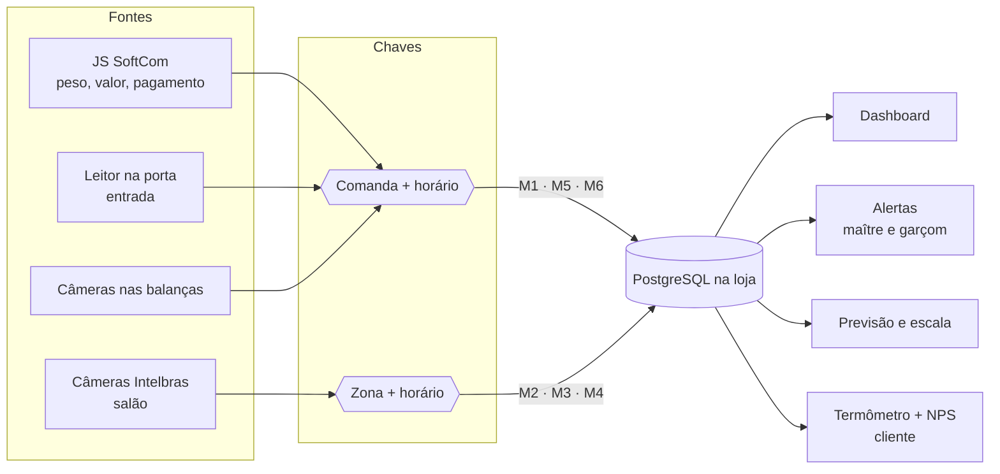
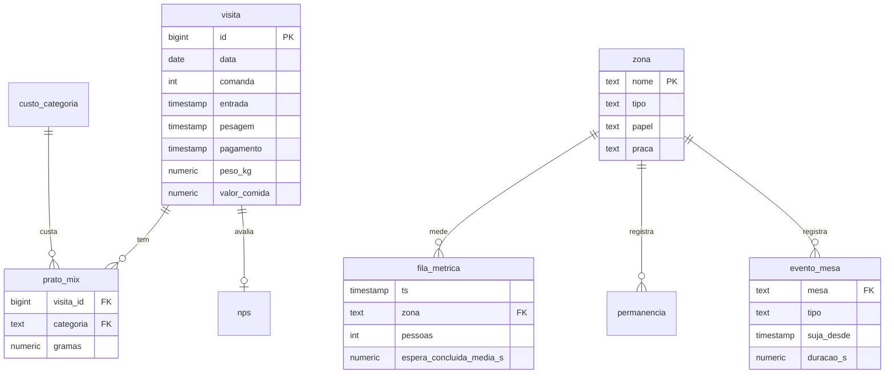

# Detalhamento e desenvolvimento do projeto

> Documento técnico do **Bovinos Insight**. A página inicial do projeto é o [README](../README.md).

## Sumário
1. [Objetivo](#1-objetivo)
2. [Como o projeto foi desenvolvido (6 passos)](#2-como-o-projeto-foi-desenvolvido-6-passos)
3. [Detalhamento técnico por módulo](#3-detalhamento-técnico-por-módulo)
4. [Integração entre as frentes](#4-integração-entre-as-frentes)
5. [Banco de dados](#5-banco-de-dados)
6. [Validação e resultados](#6-validação-e-resultados)
7. [Limitações conhecidas](#7-limitações-conhecidas)
8. [Implantação e próximos passos](#8-implantação-e-próximos-passos)
9. [Como reproduzir tudo](#9-como-reproduzir-tudo)

---

## 1. Objetivo

Transformar a operação do almoço por quilo do **Bovinos Grill & Beer (Rua Augusta)** em dados, respondendo à pergunta deixada pela própria Bovinos: *"quais informações o cliente demonstra, mas não conta?"*. Para isso, o projeto:

- usa o que a casa **já tem** (câmeras Intelbras em todo o salão, balanças integradas ao JS SoftCom, comanda com código de barras, garçons com celular);
- **respeita o escopo**: nada de cozinha, compras, estoque ou pagamentos, e nenhuma mudança no modelo por quilo;
- **preserva o acolhimento**: nada de catraca, e a recepção na porta continua humana.

---

## 2. Como o projeto foi desenvolvido (6 passos)

### Passo 1: imersão no problema
- Transcrevemos e analisamos a apresentação de abertura (Luía e Gabriel, diretoria do Grupo Bovinos).
- Extraímos os **números de calibração**:

  | Indicador | Valor |
  |---|---|
  | Clientes por dia útil | ~600 |
  | Clientes no sábado e no domingo | ~250 em cada dia |
  | Clientes por dia antes da pandemia | 850 |
  | Pico | 12h10–13h20 |
  | Lugares / mesas | ~450 / 90 |
  | Preço | R$ 119/kg |
  | Desconto | 10% antes das 12h e depois das 13h30 |
  | Fila do grill | até 4 min (meta 2,5) |
  | Churrasqueiros / garçons | 4 / 7–8 |
  | Funcionamento | 11h30–15h30 |
  | Cardápio | tema por dia da semana |

- Reconstruímos o **mapa da casa** a partir da descrição: entrada pela escada, 4 estações (saladas, quentes, sobremesas, churrasqueira), 3 balanças, 3 salões, caixas e saída.
- Priorizamos as dores pela fala da Bovinos: **mix do prato** é a mais crítica (CMV) e a **fila na escada** é o principal ponto de perda de clientes.

### Passo 2: modelo de dados
- **Decisão central:** o **número da comanda** é a chave que já liga balança, garçom e caixa no JS SoftCom. Basta acrescentar o **horário de entrada** (bip na porta) para ter a jornada completa.
- A comanda vai de 1 a 9999 e é reutilizada, então a visita é identificada por *data + comanda + horário de entrada*.
- Escrevemos o [`db/schema.sql`](../db/schema.sql): 12 tabelas e 2 visões, portável para PostgreSQL (produção) e SQLite (demo).

### Passo 3: motor de filas e mesas (visão computacional)
- **Detecção:** YOLOv8 (pessoas e louça). **Rastreamento:** ByteTrack, com IDs anônimos e temporários.
- **Zonas:** polígonos no chão definidos com o [`zone_editor`](../src/zone_editor.py).
- **Métricas e lógica:**
  - permanência por zona;
  - **Lei de Little**;
  - **desistência** (regra de 4 condições);
  - **máquina de estados das mesas**;
  - **alertas** com intervalo mínimo entre repetições.
- Arquivos: [`queue_analytics.py`](../src/queue_analytics.py), [`table_monitor.py`](../src/table_monitor.py), [`alerts.py`](../src/alerts.py), [`video_pipeline.py`](../src/video_pipeline.py).

### Passo 4: Prato Inteligente
- Detecção por nome (vocabulário aberto) com **YOLO-World**, recorte com **SAM** e distribuição do **peso real da balança** por área × densidade.
- O **cardápio do dia** (seg. virado, ter. árabe, qua. feijoada, qui. italiano, sex. frutos do mar) amplia o vocabulário do modelo.
- Arquivo: [`plate_mix.py`](../src/plate_mix.py).

### Passo 5: dados, dashboard e previsão
- **Simuladores calibrados** (ainda não temos os dados reais):
  - [`simulate_softcom.py`](../src/simulate_softcom.py): 28 dias, ~13 mil comandas;
  - [`simulate_salao.py`](../src/simulate_salao.py): 90 min de salão processados pelo **mesmo motor** do vídeo.
- **Dashboard Streamlit** com 4 abas ([`dashboard/app.py`](../dashboard/app.py)).
- **Previsão** de clientes com *Gradient Boosting* (dia da semana, chuva, feriado) e sugestão de escala ([`forecast.py`](../src/forecast.py)).

### Passo 6: validação e material de entrega
- 5 testes automatizados ([`tests/`](../tests/test_analytics.py)).
- Checagem ponta a ponta: as desistências simuladas são detectadas pelo motor.
- Prints, vídeo e slides **gerados pelo próprio código** (pasta [`scripts/`](../scripts)), portanto reproduzíveis.

---

## 3. Detalhamento técnico por módulo

### M5 · Jornada pela comanda
| Evento | Fonte | Situação |
|---|---|---|
| Entrada | leitor de código de barras na recepção | **novo** (baixo custo) |
| Pesagem | balança → JS SoftCom | já existe |
| Pagamento | caixa / totem | já existe |

- **Tempo para se servir** = pesagem − entrada.
- **Tempo total** = pagamento − entrada.
- O resultado vale para **100% dos clientes**, sem câmera.

### M2 · Fila Zero
1. **Ponto dos pés** (centro da base da caixa do YOLO), porque as zonas são desenhadas no chão.
2. **Permanência:** a pessoa entra na zona e ganha um horário de entrada. Ao ficar mais de `grace_s = 2 s` fora, a permanência é fechada. A tolerância absorve oclusões rápidas.
3. **Métricas por zona:**
   - pessoas agora;
   - espera média e máxima de quem está na fila;
   - espera média e **p90** de quem saiu nos últimos 5 min;
   - chegadas por minuto;
   - **espera estimada pela Lei de Little** (W = L / λ).
4. **Desistência:** a pessoa é contada quando cumpre as quatro condições:
   - passou pela zona de papel `entrada`;
   - **nunca** visitou uma zona `buffet`;
   - foi vista pela **última vez dentro da entrada**;
   - ficou ≥ 3 s nela.

   A terceira regra evita contar como desistência uma troca de ID do rastreador no meio do salão (há um teste para isso). Por isso, **a zona de entrada deve encostar na borda do quadro por onde o cliente volta para a rua.**
5. **Alertas:**
   - nº de pessoas ≥ limite da zona;
   - espera ≥ limite (o maior valor entre a espera atual e a recém-concluída);
   - intervalo de 2 min antes de repetir;
   - envio opcional por Telegram.
6. **Termômetro Bovinos:** publica "espera agora" para o cliente, junto com o lembrete do desconto de 10% fora do pico.

### M3 · Mesa Pronta
Máquina de estados com *debounce*:

```
LIVRE --(pessoas por 20 s)--> OCUPADA --(sem pessoas por 10 s)--> SUJA (se há louça) | LIVRE
SUJA --(sem louça e sem pessoas por 5 s)--> LIVRE        evento "mesa_limpa" (duração)
SUJA --(alguém senta por 20 s)--> OCUPADA                evento "sentou_em_mesa_suja"
```

- A louça é detectada pelas classes COCO copo, taça, garrafa, tigela, garfo, faca e colher.
- Alerta ao garçom da praça com 3 min de mesa suja.

### M1 · Prato Inteligente
1. A pesagem dispara a foto; a foto fica ligada à comanda e ao peso.
2. YOLO-World procura os alimentos por nome; o vocabulário é mapeado para 5 categorias de custo.
3. SAM recorta cada alimento. Cada pixel fica com a detecção de maior confiança.
4. **Distribuição do peso:**
   - massa relativa = área × densidade (carne 1,6 · arroz/feijão 1,3 · quentes 1,2 · sobremesa 1,0 · salada 0,5);
   - % da categoria = massa relativa ÷ soma;
   - gramas = % × **peso exato da balança**.
5. Custo da comanda = Σ gramas × custo/kg da categoria, o que dá o **CMV estimado** por dia, hora e tema.
6. **Calibração prevista:** pesar ~200 pratos por categoria, ajustar as densidades e treinar um modelo de segmentação próprio com os ~60 pratos da casa.

### M4 · Buffet Vivo *(roadmap; reaproveita M1 e M2)*
- Conta reposições de cuba (a cuba sai e volta cheia).
- Mede o resto no prato no retorno da louça, com o modelo do M1.
- Calcula um índice de atratividade: paradas diante da cuba × quem se serve × quanto sobra.

### M6 · Voz do cliente + previsão
- NPS por QR no verso da comanda, ligado ao número da comanda; análise de sentimento das avaliações do Google.
- Previsão:
  - `GradientBoostingRegressor` com dia da semana (one-hot), chuva, feriado e fim de semana;
  - fração dos clientes na hora de pico, tirada do histórico;
  - escala = clientes na hora de pico ÷ capacidade por garçom ou por churrasqueiro (parâmetros de negócio).

---

## 4. Integração entre as frentes



- **Comanda + horário** liga o que acontece com *um cliente*: entrada, prato, pagamento e nota.
- **Zona + horário** liga o que acontece no *salão*: filas, mesas e cubas.
- **O cruzamento das duas chaves é o que gera o diagnóstico.** Exemplo (ilustrativo): a comanda que deu nota 4 entrou às 12h40, levou 7,6 min até a balança (pico de fila no grill) e tinha 34% de carne no prato.

---

## 5. Banco de dados

Schema completo em [`db/schema.sql`](../db/schema.sql). O banco de demonstração em SQLite é criado com `python -m src.db` → `db/bovinos_insight.db`.



| Tabela | Conteúdo | Linhas na demo |
|---|---|---|
| `visita` | jornada de cada comanda | 13.162 |
| `prato_mix` | gramas por categoria por visita | 65.412 |
| `fila_metrica` | métricas por zona a cada 5 s | 3.276 |
| `permanencia` | entrada/saída de cada pessoa em cada zona | 894 |
| `desistencia` | clientes que voltaram da escada | 23 |
| `evento_mesa` | mesa limpa / sentou em mesa suja | 6 |
| `alerta` | alertas enviados | 55 |
| `zona`, `custo_categoria`, `unidade` | cadastros | — |
| `reposicao_cuba`, `nps` | roadmap (M4, M6) | — |

Visões: `vw_cmv_dia` (CMV estimado e % de carne por dia) e `vw_desistencias_dia`.

---

## 6. Validação e resultados

| Verificação | Resultado |
|---|---|
| Testes automatizados (`pytest`) | **5 de 5** passando |
| Desistências simuladas × detectadas (salão, 90 min) | **23 de 23** |
| Desistências simuladas × detectadas (cena do vídeo) | **8 de 8** |
| Troca de ID no salão contada como desistência | **não** (teste dedicado) |
| Alertas não se repetem antes de 2 min | ok (teste dedicado) |
| Ciclo mesa suja → limpa com duração correta | ok (teste dedicado) |

**O que os dados simulados mostram** (calibrados com os números da Bovinos, portanto ilustrativos):
- tempo médio da entrada até a balança de **~4,2 min** fora do pico, contra **~8,0 min** às 12h45 (p90 de 10,4 min);
- ticket médio de **R$ 68**, peso médio de **533 g**, **24%** de carne no prato e CMV estimado de **~21%**;
- espera no grill acima da meta de 2,5 min no pico da simulação, com alerta ao maître.

---

## 7. Limitações conhecidas

- **Dados sintéticos:** os números da demo não são da Bovinos. Os simuladores existem para provar o pipeline até chegarem os dados reais (histórico do JS SoftCom e vídeo de 1h30 da operação).
- **Detector no vídeo real:** o pipeline YOLO + ByteTrack está implementado, mas ainda não rodou no vídeo da Bovinos, que estava sendo processado (blur). Precisa ajustar as zonas, o `conf` e o modelo (`yolov8s` se o `yolov8n` perder pessoas).
- **Oclusão e troca de ID:** em salão cheio o rastreador pode trocar IDs. A regra de desistência foi desenhada para isso, mas a precisão precisa ser medida em amostras rotuladas.
- **Prato Inteligente:** as densidades são hipóteses até a calibração com pratos pesados. A segmentação zero-shot erra em pratos misturados (farofa sobre a carne, molhos).
- **Integração JS SoftCom:** depende do fornecedor (leitura no banco local ou export). O plano B é o CSV do fechamento.
- **Custos por kg e capacidade por funcionário** são parâmetros a preencher com a Bovinos.

---

## 8. Implantação e próximos passos

| Fase | Prazo | Entrega |
|---|---|---|
| 0 · Quick win | 1 semana | Histórico do JS SoftCom + bip na porta + dashboard |
| 1 · Filas | 2–4 semanas | Edge box, Fila Zero nas câmeras atuais, alertas, Termômetro |
| 2 · Prato | 1–2 meses | Câmeras nas balanças, calibração, modelo próprio |
| 3 · Salão | 2–3 meses | Mesa Pronta, Buffet Vivo, NPS por QR |
| 4 · Escala | depois | Alameda Santos (comparação), depois as 13 unidades |

---

## 9. Como reproduzir tudo

```bash
pip install -r requirements.txt
python -m src.simulate_softcom        # comandas sintéticas
python -m src.simulate_salao          # salão simulado -> outputs/
python -m src.db                      # banco SQLite da demo
python -m pytest -q                   # testes
streamlit run dashboard/app.py        # dashboard

# material de entrega (precisa de Chrome + Playwright)
python scripts/gerar_prints.py        # docs/prints/*.png
python scripts/gerar_video.py         # docs/video/bovinos_insight_demo.mp4
python scripts/gerar_slides_pdf.py    # docs/apresentacao_5_slides.pdf
```
